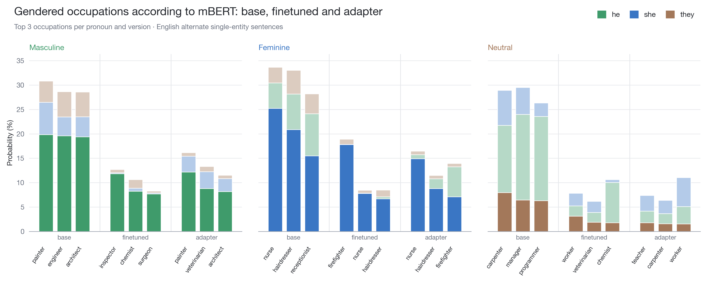

# Pronominal Gender Bias in Language Models with Language Adapters

Code and results of my master's thesis. How do language models resolve and predict *she*, *he* and *they*
(她 / 他 / TA), and does a language adapter change their gender bias?

- **Data:** parallel English and Chinese Winogender datasets. The English one builds on
  [Winogender](https://github.com/rudinger/winogender-schemas) (Rudinger et al., 2018), made grammatical for the
  neutral *they*; the Chinese one was constructed for this thesis. Each sentence comes in a two-person
  (occupation + participant) and a one-person version.
- **Tasks:**
  - **coreference resolution**: who does the pronoun refer to? Asked with several prompt types (yes/no, direct,
    option, who), to masked (MLM) and generative models;
  - **pronoun prediction**: which pronoun does a masked language model put in "The technician said that [MASK]
    felt happy."?
- **Models:** monolingual vs. multilingual models first (BERT, RoBERTa, mBERT, XLM-RoBERTa, T5, FLAN-T5, mT5,
  ChatLM). Then mBERT and XLM-RoBERTa in three versions: **base**, **fully finetuned** and with a **language
  adapter**, both trained on English or Chinese Wikipedia.



## Structure

The pipeline has four stages. Each stage is a folder with one script and reads only the output of the stages before it.

| Stage | Folder | Script | Output |
|---|---|---|---|
| 1. Data | `data/` | `build_data.py` | sentences and prompts, from the hand-written templates in `data/sources/` |
| 2. Model training | `model_training/` | `train.py` | finetuned and adapter versions of mBERT and XLM-RoBERTa (needs a GPU) |
| 3. Task execution | `task_execution/` | `run_tasks.py` | model outputs for both tasks, in `task_execution/outputs/` |
| 4. Evaluation | `evaluation/` | `evaluate.py` | tables and figures, in `evaluation/results/` |

The data, the model outputs of the thesis and the results are all included, so each stage can be run on its own.
Every script has `--list`, which shows what it can run and where it writes.

## Installation

```bash
pip install -r requirements.txt                    # data, task execution, evaluation (Python 3.11)
pip install -r model_training/requirements.txt     # training and the adapter models: a separate environment
```

## Running

```bash
# 1. data
cd data
python build_data.py                     # all sentences and prompts, EN and ZH

# 2. model training (GPU)
cd ../model_training
python train.py --list                   # the 8 trainings
python train.py --method adapter --model mBERT --lang en

# 3. task execution
cd ../task_execution
python run_tasks.py --list               # all inputs and models
python run_tasks.py --model BERT --lang en
python run_tasks.py --model mBERT --lang zh --version adapter

# 4. evaluation
cd ../evaluation
python evaluate.py                       # all tables and figures, about 30 s
```

The trained model weights are not included. The training data and the configuration of each training run are on
[Hugging Face](https://huggingface.co/datasets/JingyanChen22/pronominal-gender-bias-training).

## Results

`evaluation/results/`:

- `coreference/<lang>/`
  - `prompt_types_*.tsv`: accuracy per prompt type
  - `single_vs_double_*.tsv`: one-person vs. two-person sentences
  - `versions.tsv`: base vs. finetuned vs. adapter, per gender
- `pronoun_prediction/<lang>/figures/`: the most gendered occupations per pronoun, for each model and version
- `pronoun_prediction/bias_versions.tsv`: gender bias scores of the three versions

## License

[MIT](LICENSE)
